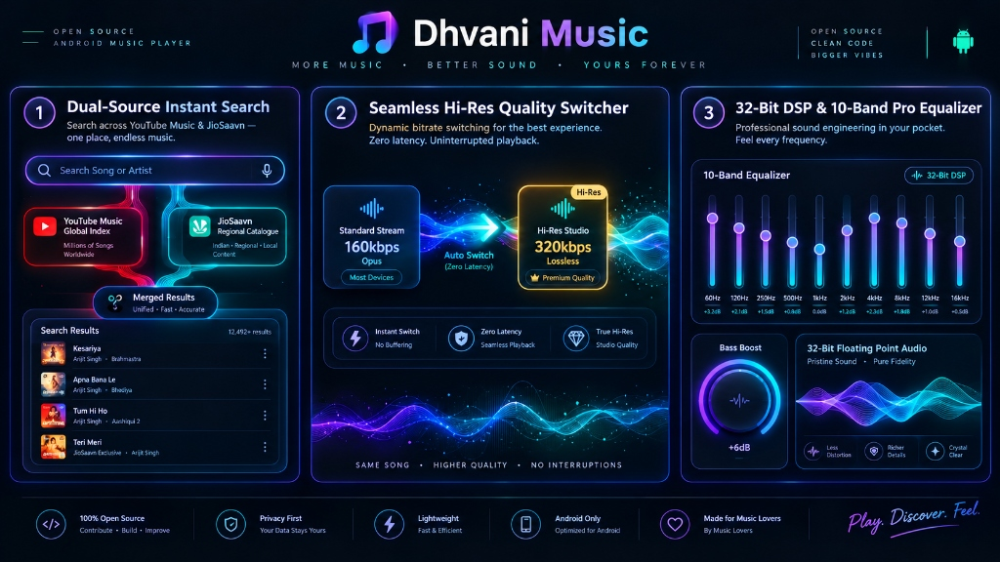

<div align="center">

# 🎵 Dhvani Music


### *Premium Indian & Global Music — Ad-Free, Open Source, Beautiful*

[](https://github.com/Kanaiya-rgb/Dhvani-Music/releases/latest)
[](https://github.com/Kanaiya-rgb/Dhvani-Music/releases)
[](https://kotlinlang.org)
[](https://developer.android.com/jetpack/compose)
[](https://m3.material.io)
[](https://developer.android.com/media/media3)
[](LICENSE)

<br/>

[](https://discord.gg/cQkNcqCwkA)
[](https://ko-fi.com/kanaiya_rgb)
[](https://buymeacoffee.com/kanaiya_rgb)

<br/>

[📥 Download](#-download--installation) · [💬 Discord](https://discord.gg/cQkNcqCwkA) · [📐 Showcases](#-technical-showcases) · [✨ Features](#-features) · [🏛️ Architecture](#-architecture--tech-stack) · [🛠️ Build](#-build-from-source) · [❓ FAQ](#-frequently-asked-questions) · [🙏 Credits](#-credits--acknowledgements)

</div>

---

> [!WARNING]
> **Dhvani Music is not affiliated with, endorsed by, or connected to YouTube, Google, Spotify, or any of their subsidiaries in any way. Use at your own discretion.**

---

## 📖 What is Dhvani Music?

**Dhvani Music** is a feature-rich, open-source Android music client built for those who refuse to compromise. It fuses **YouTube Music's massive catalogue** with **Hi-Res lossless audio**, **real-time synced lyrics**, **Ambient Cinema landscape mode**, a **studio ringtone trimmer & audio editor**, and an expressive **Material 3 / Frosted-Glass UI** — all completely ad-free and privacy-first.

Built from the ground up in modern Kotlin with Jetpack Compose and AndroidX Media3, Dhvani is a next-generation music player designed to look premium, feel snappy, and sound incredible.

---

## 📐 Technical Showcases

<div align="center">
  
</div>

<br/>

| 🔍 1. Dual-Source Instant Search | ⚡ 2. Seamless Hi-Res Quality Switcher | 🎛️ 3. 32-Bit DSP & 10-Band Pro Equalizer |
|:---|:---|:---|
| Unified search engine indexing **YouTube Music's global catalogue** and **JioSaavn's regional database** simultaneously with accurate matching. | Intelligent dynamic bitrate auto-switching from **160kbps Opus** to **320kbps Lossless** with zero latency and uninterrupted playback. | Studio sound engineering with hardware **10-band graphic equalizer**, dynamic **Bass Boost (+6dB)**, and **32-bit floating-point DSP**. |

---

## ✨ Features

### 🎧 Playback & Dual-Source Audio Engine

| Feature | Details |
|:---|:---|
| **Dual-Source Streaming Engine** | Unified simultaneous streaming pipeline querying both **YouTube Music** (160kbps Opus) and **JioSaavn** (up to 320kbps Lossless) with zero-latency switching. |
| **Seamless Hi-Res Quality Switcher** | Dynamic quality sheet allowing instant switching between standard and studio high-fidelity streams during live playback. |
| **Ad-Free YouTube Music** | Complete YouTube Music catalog — search, browse, queue, and stream with zero ads and zero interruptions. |
| **Hi-Res Lossless Audio** | FLAC/ALAC lossless audio streams up to 24-bit/192kHz via pluggable module sources with intelligent fallback. |
| **Gapless Crossfade** | Smooth, configurable 0–12 second crossfades between tracks so your music never stops. |
| **Automix (Beat-Match DSP)** | Native C++ `dhvani_analysis` engine with tempo alignment and automated beat-matched transitions. |
| **3D Spatial Audio & Surround** | Binaural DSP surround soundstage with dedicated per-mode equalizer curve presets. |
| **10-Band Graphic Equalizer** | Studio frequency sculpting with custom preset profiles (Bass Boost, Acoustic, Vocal Enhancer, Treble Booster, etc.). |
| **Dolby Atmos / System DSP** | Direct integration with device hardware Dolby Atmos panel when supported. |
| **Live Audio Pipeline Inspector** | Real-time DSP sheet displaying active bitrate, codec, bit depth, sample rate, and network buffer telemetry. |
| **Per-Network Quality Control** | Independent audio quality ceilings for Wi-Fi and mobile data to conserve bandwidth. |
| **Skip Silence & Speed Control** | Automatically bypass dead air in intros, plus 0.5× to 2.0× fine-grained playback speed control. |

---

### ✂️ Studio Ringtone Trimmer & Audio Tools *(New in v2.7.0)*

| Tool | Capabilities |
|:---|:---|
| **Interactive Waveform Visualizer** | Zoomable waveform editor with millisecond-precision draggable crop handles. |
| **Live Preview Playback** | Instant loop previewing of your trimmed section before saving or applying. |
| **Fade In & Fade Out** | Smooth acoustic transitions to avoid abrupt starts or clicks. |
| **1-Tap System Setup** | Directly apply custom trimmed audio as **Phone Ringtone**, **Notification Tone**, or **Alarm Sound** with native Android permission handling. |

---

### 🔀 Alternative Song Versions Sheet *(New in v2.7.0)*

Explore every version of your favorite tracks in a single tap:
- **Acoustic & Unplugged**: Raw, stripped-down vocal and guitar/piano renditions.
- **Slowed & Reverb**: Atmospheric, ethereal nocturnal vibes.
- **Speed Up / Nightcore**: High-tempo, energetic dance edits.
- **Live & Concert**: Electrifying live festival and tour recordings.
- **8D & Spatial Audio**: Immersive rotating binaural headphone experiences.
- **Instrumental & Karaoke**: Clean backing tracks with isolated vocals removed.

---

### 🎬 Ambient Cinema & Visual Player

| Feature | Details |
|:---|:---|
| **Ambient Cinema Landscape Mode** | Auto-rotate to a fullscreen cinematic landscape player when tilting your phone. Immersive ambient glow, vinyl turntable, and live playback controls. |
| **Zero-Login Spotify Canvas Loops** | Hypnotic vertical video loops powered by cloud key resolvers — no personal Spotify SP_DC login required. Supports Apple Music motion art. |
| **Custom Seekbar Sync** | Unique seekbar styles (Capsule, Wavy, Squiggle, Retro Vinyl, Geometric, etc.) stay synchronized across Portrait and Landscape views. |
| **Multi-Point Mesh Gradient** | Fluid, multi-color mesh gradient backgrounds that adapt dynamically to every album cover's palette. |
| **Frosted Glassmorphism UI** | Silky translucent navigation bars, bottom sheets, and player overlays with real-time hardware blur. |
| **Dynamic Artwork Color Theming** | Album cover palette extracted and applied across the entire player UI on every track change. |

---

### 🎤 Synchronized Lyrics & Lyric Focus

| Feature | Details |
|:---|:---|
| **Lyric Focus Mode *(New in v2.7.0)*** | Full-screen distraction-free lyric view with buttery-smooth line tracking and active line glow. |
| **Multi-Source Engine & LrcRed** | Redundant fallback chain spanning **LrcRed**, **LRCLIB**, **Musixmatch**, **Kugou**, **Genius**, and **YouTube** for deep Indian and global lyric coverage. |
| **12+ Kinetic Lyrics Text Effects** | Physics-based animations: Neon, Glitch, Ocean Wave, Aurora, Ember, Chrome, CRT, Sine Wave, Smoke, Kinetic Equalizer, Ghostwrite, and Typewriter. |
| **Word-by-Word Syllable Sync** | Syllable-level highlighting for supported tracks with real-time position seeking. |
| **Lyrics Share Card Generator** | Select up to 7 lyric lines and export an aesthetic quote card for WhatsApp, Instagram, or Twitter (Story 9:16 or Square 1:1). |
| **Inline Translation** | Real-time lyric translation across 100+ languages. |

---

### 💬 In-App Discord Community & Social *(New in v2.7.0)*

- **In-App Community Hub**: Dedicated Discord screen inside the app with direct join link (`discord.gg/cQkNcqCwkA`), release channels, and bug tracker access.
- **Discord Rich Presence (RPC)**: Live track, artist, album artwork, and real-time playback elapsed bar displayed on your Discord profile.
- **Listen Together**: Synchronized group listening rooms with host controls and guest room codes.
- **Last.fm & ListenBrainz Scrobbling**: Native scrobbling with configurable timing thresholds.
- **YouTube Music Sync**: Optional Google account sign-in to sync liked songs, playlists, and history.

---

### 📱 Home-Screen Widgets

| Widget | Style | Details |
|:---|:---|:---|
| **Pill Widget** | 4×1 compact | Sleek modern pill with album art, track title, and responsive playback controls. |
| **Turntable Widget** | 3×3 vinyl | Retro spinning turntable disc with live spinning state and media controls. |

---

### 🎨 Customization & Appearance

- **12+ Player Seekbar Styles**: Capsule, Wavy, Squiggle, Retro Vinyl, Equalizer Bar, Minimalist Line, Geometric.
- **Pure AMOLED Black, Dynamic HSL Accent, and Dark/Light Modes.**
- **High Refresh Rate**: Silky smooth 90Hz/120Hz scrolling support.
- **Dynamic Island Notch Player**: Floating mini-player with live frequency equalizer animation on compatible devices.
- **Granular UI Control**: Configurable grid cell density, mini player background styles, and bottom navigation bar aesthetics.

---

### 🧭 Explore: 50+ Moods, Genres & 15+ Languages

| Section | Highlights |
|:---|:---|
| **Multi-Language Exploration *(New in v2.7.0)*** | Dedicated language filters for Hindi, Punjabi, Tamil, Telugu, Bhojpuri, Gujarati, Bengali, Malayalam, Kannada, Marathi, English, Spanish, Korean, and more. |
| **Moods & Moments** | Chill ☕ · Focus 📚 · Workout 🏋️ · Party 🎉 · Romance 💖 · Sleep 🌙 · Sad 💔 · Commute 🚗 |
| **Charts & Curated Mixes** | Top 20 Global, Trending Regional, New Releases, Viral Hits, and Podcasts. |

---

### 💾 Offline, Downloads & Local Music

- **Full Metadata Embedding**: Downloaded tracks auto-embed 3000×3000 album covers, artist, title, album, and ID3 lyrics tags.
- **Local Storage Scanner**: Scan and play local audio files from internal storage or SD cards with gapless support.
- **Smart Auto-Download**: Auto-cache or download liked songs and repeat favorites in the background.
- **Fast Playlist Import/Export**: Parallel coroutine engine importing Spotify playlists **6× faster** (Spotify, YouTube Music, M3U/JSON).

---

## 📦 Download & Installation

### ⬇️ Direct GitHub Release *(Recommended)*

| Platform | Link |
|:---|:---|
| **Latest APK** | [📥 Download DhvaniMusic-v2.7.0.apk](https://github.com/Kanaiya-rgb/Dhvani-Music/releases/latest) |
| **All Releases** | [📋 View Release History](https://github.com/Kanaiya-rgb/Dhvani-Music/releases) |

### 📲 Installation Steps
1. Download the `.apk` from the [Releases page](https://github.com/Kanaiya-rgb/Dhvani-Music/releases/latest).
2. Go to **Settings → Apps → Special App Access → Install Unknown Apps** and allow installation from your browser/file manager.
3. Tap the downloaded APK → **Install**.
4. Open Dhvani Music and enjoy!

> [!TIP]
> For best performance, go to **Settings → Apps → Dhvani Music → Battery** and set it to **Unrestricted** to prevent Android from throttling background playback.

---

## 🏛️ Architecture & Tech Stack

Dhvani Music is a modern, single-activity Android application built with clean separation of concerns and reactive state management throughout.

```
Single Activity (MainActivity.kt)
│
├── 🎨 UI Layer (Jetpack Compose + Material 3)
│   ├── Screens      → Home, Search, Library, Explore, Local Music, Settings
│   ├── Player       → NowPlaying, Ambient Cinema Landscape, Canvas Artwork
│   ├── Components   → MiniPlayer, Dynamic Island, 12+ Seekbar Styles, Dialogs
│   └── Theme        → Dynamic HSL palette, Glassmorphism, Typography, Shapes
│
├── 🔊 Playback Engine (AndroidX Media3 + ExoPlayer + C++ DSP)
│   ├── PlaybackService   → Foreground MediaSession with full notification
│   ├── AudioEngine       → Decoupled playback pipeline abstraction layer
│   ├── PlaybackEngine    → Crossfade, speed control, gapless transitions
│   ├── ChunkedDataSource → Progressive chunked streaming & LRU disk cache
│   ├── EqualizerManager  → 10-band EQ, Dolby panel, spatial audio DSP
│   └── dhvani_analysis   → Native C++ beat-tempo detector & DSP analyzer
│
├── 🌐 Data & API Layer (Ktor + KotlinX Serialization + Room DB)
│   ├── innertube/         → YouTube Music stream resolver & InnerTube parser
│   ├── lyrics/            → Multi-source synced lyrics engine
│   ├── playlist/          → Import, export, sync & playlist manager
│   ├── canvas/            → Spotify & community canvas video resolver
│   └── settings/          → Reactive DataStore preferences (AppSettings.kt)
│
└── ⚙️ System & Integrations
    ├── widget/            → Glance home-screen widgets (Pill 4×1, Turntable 3×3)
    ├── listentogether/    → Real-time synchronized group listening
    ├── FCM Notifications  → Firebase Cloud Messaging update alerts
    └── discord/           → Discord Rich Presence RPC integration
```

### 🔧 Core Technology

| Layer | Technology |
|:---|:---|
| **Language** | Kotlin 2.3 |
| **UI** | Jetpack Compose + Material 3 (Material You) |
| **Playback** | AndroidX Media3 / ExoPlayer |
| **Native DSP** | C++ (NDK 28, CMake 3.22.1) |
| **Networking** | Ktor + OkHttp |
| **Serialization** | KotlinX Serialization |
| **Database** | Room DB |
| **Preferences** | AndroidX DataStore |
| **Glassmorphism** | Haze library |
| **Home Widgets** | AndroidX Glance |
| **Push** | Firebase Cloud Messaging |

---

<details>
<summary><b>📂 Full Repository Directory Tree</b></summary>
<br/>

```plaintext
Dhvani-Music/
│
├── 📱 app/                                    # Primary Android Application
│   └── src/main/java/com/music/dhvani/
│       ├── 🌟 MainActivity.kt                 # Single Activity root nav host
│       ├── 🚀 DhvaniApplication.kt            # App lifecycle, crash, channels
│       │
│       ├── 🎨 ui/
│       │   ├── screens/
│       │   │   ├── HomeScreen.kt              # Personalized feed & carousels
│       │   │   ├── SearchScreen.kt            # Real-time search & voice input
│       │   │   ├── LibraryScreen.kt           # Playlists, liked songs, downloads
│       │   │   ├── LocalMusicScreen.kt        # Local device storage scanner
│       │   │   ├── SettingsSheet.kt           # Central settings bottom sheet
│       │   │   ├── AppearanceSettingsScreen.kt # Theme, seekbars, canvas styles
│       │   │   ├── AccountAndScrobblingScreen.kt # Last.fm, ListenBrainz, Discord
│       │   │   ├── ListenTogetherScreen.kt    # Real-time group listening rooms
│       │   │   ├── DiscordScreen.kt           # 🆕 In-app Discord community hub
│       │   │   └── SourcesScreen.kt           # Audio source & quality config
│       │   │
│       │   ├── player/
│       │   │   ├── NowPlayingScreen.kt        # Fullscreen portrait player
│       │   │   ├── AmbientCinemaLandscapeOverlay.kt # Landscape cinema mode
│       │   │   ├── LyricFocus.kt              # 🆕 Distraction-free synced lyric view
│       │   │   ├── AudioPipelineSheet.kt      # Live DSP telemetry inspector
│       │   │   ├── LyricsShareCardSheet.kt    # 7-line lyrics image generator
│       │   │   ├── LyricsSourcePickerSheet.kt # On-the-fly lyrics source picker
│       │   │   └── CanvasArtworkPlayer.kt     # Spotify/Apple Motion canvas loops
│       │   │
│       │   ├── components/
│       │   │   ├── RingtoneTrimmerSheet.kt    # 🆕 Studio waveform ringtone trimmer
│       │   │   ├── SongVersionsSheet.kt       # 🆕 Alternative versions discoverer
│       │   │   ├── PlayerSliders.kt           # 12+ custom kinetic seekbar styles
│       │   │   ├── AudioPipelineDialog.kt     # Quick stream info overlay
│       │   │   ├── SongActionsSheet.kt        # Track long-press context menu
│       │   │   ├── ImportPlaylistSheet.kt     # Parallel playlist import (6× faster)
│       │   │   └── ...                        # Other dialogs & sheets
│       │   │
│       │   └── theme/                         # Colors, Typography, Shapes
│       │
│       ├── 🔊 playback/
│       │   ├── PlaybackService.kt             # Foreground MediaSession service
│       │   ├── AudioEngine.kt                 # Decoupled audio pipeline
│       │   ├── PlaybackEngine.kt              # Crossfade & gapless engine
│       │   ├── ChunkedDataSource.kt           # Progressive HTTP streaming cache
│       │   └── eq/EqualizerManager.kt         # 10-band EQ + Dolby DSP manager
│       │
│       ├── 🌐 data/
│       │   ├── innertube/                     # YouTube Music stream resolver
│       │   ├── jiosaavn/                      # 🆕 JioSaavn 320kbps lossless provider
│       │   ├── lyrics/                        # Multi-source lyrics (LrcRed, LRCLIB)
│       │   ├── playlist/                      # CRUD, import & sync managers
│       │   ├── canvas/CommunityCanvas.kt      # Community & cloud canvas resolver
│       │   ├── model/SongLanguage.kt          # 🆕 15+ language regional catalog
│       │   ├── DhvaniFirebaseMessagingService.kt # FCM push update alerts
│       │   └── settings/AppSettings.kt        # Reactive DataStore preferences
│       │
│       ├── ✂️ ringtone/
│       │   └── RingtoneHelper.kt              # 🆕 Native ringtone/alarm export engine
│       │
│       └── 📱 widget/
│           ├── MediaWidgetPill.kt             # 4×1 compact pill widget
│           └── MediaWidgetTurntable.kt        # 3×3 retro vinyl widget
│
├── 🟢 spotify/                                # Spotify Canvas extraction service
├── 🤝 CONTRIBUTING.md                         # Contributor onboarding guide
├── 🗺️ PROJECT_STRUCTURE.md                    # Full file-by-file architecture map
├── ⚡ version.json                             # OTA update manifest
└── 📜 LICENSE                                 # GNU GPLv3
```
</details>

> 💡 For the complete file-by-file guide, see **[PROJECT_STRUCTURE.md](PROJECT_STRUCTURE.md)**.

---

## 🛠️ Build from Source

### Prerequisites
- **Android Studio** Ladybug (2024.2.1+) or newer
- **JDK 17** or JDK 21
- **Android SDK**: compileSdk 36, minSdk 26
- **Android NDK** `28.2.13676358` + CMake 3.22.1

### Build Instructions
```bash
# 1. Clone the repository
git clone https://github.com/Kanaiya-rgb/Dhvani-Music.git
cd Dhvani-Music

# 2. Compile check (fast — no APK, just Kotlin validation)
./gradlew :app:compileProdReleaseKotlin

# 3. Build Dev Debug APK (for development/testing)
./gradlew assembleDevDebug
# Output: app/build/outputs/apk/dev/debug/app-dev-debug.apk

# 4. Build Production Release APK (signed)
./gradlew assembleProdRelease
# Output: app/build/outputs/apk/prod/release/app-prod-release.apk
```

> [!NOTE]
> **Local secrets** (Last.fm API key, Spotify SP_DC token, Module Index URL) are read from `local.properties` which is git-ignored. The app builds cleanly without them — features that require them will gracefully show a "not configured" state in Settings.

---

## ⚙️ Setup & Optimization

### Disable Battery Optimization *(Important for Background Playback)*
1. **Settings → Apps → Dhvani Music → Battery**
2. Select **Unrestricted** (or "Don't optimize")
3. This ensures unbroken playback when screen is locked.

### Android Auto Setup
1. Open **Android Auto Settings** → tap **Version** 10 times to enter Developer mode.
2. Tap **⋮ → Developer Settings → Unknown sources**.
3. Connect to vehicle; Dhvani Music appears in media dashboard.

---

## 📱 Supported Android Versions

| Android Version | Support |
|:---|:---|
| Android 8.0 Oreo (API 26) | ✅ Minimum supported |
| Android 10–12 | ✅ Full support |
| Android 13 | ✅ Full support (themed icons, media permissions) |
| Android 14 | ✅ Full support (predictive back, photo picker) |
| Android 15 | ✅ Full support (edge-to-edge enforcement, 120Hz) |

---

## ❓ Frequently Asked Questions

<details>
<summary><b>Q: Do I need YouTube Music Premium?</b></summary>
<br/>
No. Dhvani streams freely using public and authenticated YouTube Music InnerTube APIs. All features — background playback, ad-blocking, high quality — work without any paid subscription.
</details>

<details>
<summary><b>Q: How does Lossless Audio work?</b></summary>
<br/>
Dhvani supports pluggable module resolvers (FLAC/ALAC up to 24-bit/192kHz). When enabled in Settings → Sources, it queries the lossless catalog and falls back seamlessly to YouTube Music's AAC stream if unavailable.
</details>

<details>
<summary><b>Q: Can my Google account get banned?</b></summary>
<br/>
Dhvani uses standard read-only InnerTube client protocols. It does not manipulate watch hours or abuse platform resources. You can also use it completely signed out.
</details>

<details>
<summary><b>Q: Does it work with Bluetooth / Android Auto?</b></summary>
<br/>
Yes. Audio is routed through the standard Android AudioManager + Media3 ExoPlayer stack. Full Bluetooth codec support (LDAC, aptX, AAC, SBC), media key controls, and Android Auto are all supported.
</details>

<details>
<summary><b>Q: How do I get the Ambient Cinema mode?</b></summary>
<br/>
Simply tilt your phone to landscape while the Now Playing fullscreen player is open. Dhvani automatically transitions into the full Ambient Cinema mode with live controls and ambient lighting.
</details>

---

## ☕ Support the Project

Dhvani Music is completely free, open-source, and ad-free. If you enjoy it, consider supporting active development:

<div align="center">

<a href='https://ko-fi.com/kanaiya_rgb' target='_blank'>
  
</a>
&nbsp;&nbsp;
<a href='https://buymeacoffee.com/kanaiya_rgb' target='_blank'>
  
</a>

<br/><br/>

[](https://ko-fi.com/kanaiya_rgb)
&nbsp;
[](https://buymeacoffee.com/kanaiya_rgb)

</div>

---

## 🤝 Contributors

<div align="center">

<a href="https://github.com/Kanaiya-rgb">
  
</a>
&nbsp;&nbsp;
<a href="https://github.com/claude">
  
</a>

<br/><br/>

Want to contribute? Read **[CONTRIBUTING.md](CONTRIBUTING.md)** to get started!

</div>

---

## 💬 Community & Discussion

Have questions, feature suggestions, or bug reports? Join our vibrant community of music lovers and testers on Discord:

<div align="center">

[](https://discord.gg/cQkNcqCwkA)

</div>

---

## 🙏 Credits & Acknowledgements

Dhvani Music is built with deep gratitude to these open-source projects:

- **[BitChord](https://github.com/kushagrasinghx/BitChord)** by [Kushagra Singh](https://github.com/kushagrasinghx) — Pioneering architecture, YouTube Music stream integration, and aesthetic UI foundations.
- **[Meld](https://github.com/FrancescoGrazioso/Meld)** by [Francesco Grazioso](https://github.com/FrancescoGrazioso) — Material 3 design, playlist management, and open-source Android music ecosystem contributions.
- **[NewPipeExtractor](https://github.com/TeamNewPipe/NewPipeExtractor)** — Robust, lightweight YouTube stream extraction infrastructure.
- **[AndroidX Jetpack Compose](https://developer.android.com/jetpack/compose)** & **[Media3](https://developer.android.com/media/media3)** — The modern foundation powering our entire audio engine and UI.
- **[Haze](https://github.com/chrisbanes/haze)** by Chris Banes — Beautiful real-time glassmorphism blur effects.
- **[binimum](https://github.com/binimum)** — Apple Music-style real-time synced lyrics animations and APIs.
- **[LRCLIB](https://lrclib.net/)** — Open-source community synchronized lyrics database.
- **[Discord-RPC / Kizzy](https://github.com/cptpieface/discord-rpc)** — Real-time Discord Rich Presence streaming status integration.
- **[Claude](https://claude.ai)** by Anthropic — AI pair programming assistance for architecture design and codebase refinements.

---

## ⚖️ Disclaimer & Legal Notice

**Dhvani Music is an independent, community-driven third-party audio player.** It is not associated with, sponsored by, or affiliated with Google LLC, YouTube, Alphabet Inc., Spotify AB, or any of their subsidiaries.

- **No Media Hosting**: Dhvani does not host, upload, or store copyrighted music files. It acts purely as a client communicating with public or user-authenticated APIs.
- **Fair Use**: This software is developed for personal research and educational purposes. Users are individually responsible for compliance with regional copyright laws and terms of service.
- **Copyleft**: Licensed under **GNU GPL v3.0** — any redistribution or derivative must remain open-source under the same license.

---

## 📜 License

This project is licensed under the **GNU General Public License v3.0**.
See the [LICENSE](LICENSE) file for full details.

---

<div align="center">

Made with ❤️ by [Kanaiya-rgb](https://github.com/Kanaiya-rgb)

**Dhvani Music** • [Discord](https://discord.gg/cQkNcqCwkA) • [Releases](https://github.com/Kanaiya-rgb/Dhvani-Music/releases) • [Issues](https://github.com/Kanaiya-rgb/Dhvani-Music/issues) • [CONTRIBUTING.md](CONTRIBUTING.md)

</div>
